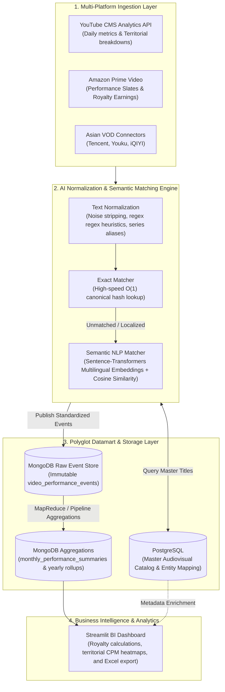

# 🎬 Streaming Matching AI & Multi-Platform BI Platform

[](https://www.python.org/)
[](https://en.wikipedia.org/wiki/Hexagonal_architecture_(software))
[](https://huggingface.co/)
[](https://www.mongodb.com/)
[](https://www.postgresql.org/)
[](https://streamlit.io/)
[](https://docs.pytest.org/)
[](LICENSE)

An enterprise-grade data engineering platform, NLP matching engine, and Business Intelligence portal designed to ingest, reconcile, and analyze multi-million video performance events across global VOD platforms (**YouTube CMS**, **Amazon Prime Video**, and Asian networks like **Tencent Video**, **Youku**, and **iQIYI**) against a centralized canonical audiovisual catalog.

---

## 🎯 The Problem & Engineering Challenge

In the digital media distribution industry, distributor reporting is notoriously fragmented:
* **Inconsistent Nomenclature:** Distributors label the same episode differently across regions (e.g., `"S02E05"`, `"Ep. 5 - The Race"`, or localized international titles with noisy bracket tags like `"[Full HD] (Spanish Dub)"`).
* **Multi-Currency Discrepancies:** Earnings are settled in mixed currencies (USD, EUR, CNY) under disparate accounting models (AVOD ad-revenue sharing, SVOD subscription royalties, and transactional TVOD).
* **Data Scale & Concurrency:** Processing multi-million raw event logs across hundreds of channels and territories requires pre-aggregated rollups to deliver sub-second analytical dashboard queries.

**Streaming Matching AI** solves this with an end-to-end automated pipeline featuring **Hexagonal Architecture**, an **AI-driven semantic reconciliation engine**, and high-throughput **MongoDB datamart aggregations**.

---

## 🏗️ System Architecture



---

## 🧠 Multi-Tiered AI Matching Engine

The core reconciliation pipeline in `core/matching/` resolves discrepancies through a three-stage cascade:

```
[Raw External Title]
         │
         ▼
 ┌──────────────────────────────────────────────┐
 │  Phase 0: Rule-Based Normalizer & Heuristics │ -> Strips episode/season tags, emojis, dub markers
 └──────────────────────┬───────────────────────┘
                        │
                        ▼
 ┌──────────────────────────────────────────────┐
 │  Phase 1: Fast Normalized String Matching    │ -> Instant match against canonical titles & aliases
 └──────────────────────┬───────────────────────┘
                        │ (If unresolved)
                        ▼
 ┌──────────────────────────────────────────────┐
 │  Phase 2: Semantic NLP Cross-Language Match  │ -> Generates sentence embeddings (MiniLM / MPNet)
 └──────────────────────────────────────────────┘   Calculates cosine similarity with confidence thresholds
```

1. **Exact & Alias Matching (`exact.py`):** Ultra-fast lookup matching normalized alphanumeric signatures and known regional series aliases.
2. **Heuristic Hybrid Normalization (`title.py`, `series_alias.py`):** Cleans regional noise, bracket notations (`【...】`, `[...]`), and bilingual episode tags.
3. **Semantic Embedding Matcher (`semantic.py`):** Embeds titles into dense vector space using HuggingFace `sentence-transformers`, matching translated and colloquial titles with high cosine similarity (>0.85 threshold).

---

## 🛠️ Repository Organization

```text
streaming-matching-ai/
├── apps/
│   ├── dashboard/          # Streamlit Interactive BI Dashboard
│   │   ├── app.py          # Unified entrypoint & navigation
│   │   ├── pages/          # Financial summaries, catalog audit, and operations
│   │   └── utils/          # Database connection pooling & custom styling
│   └── event_manager/      # Domain event producer (YouTube Analytics API)
├── core/                   # Core Business Domain & Hexagonal Ports
│   ├── domain/             # Domain entities, exchange rates, currency conversion
│   ├── ingestion/          # Orchestrators (Cloud storage sync, CSV/Excel parsers)
│   ├── matching/           # Exact, Heuristic & NLP Semantic Matchers
│   ├── normalization/      # Text cleaners, episode extractors & catalog enrichers
│   └── repositories/       # Abstract Protocols & DB adapters (PostgreSQL, MongoDB)
├── scripts/                # Automated batch processing, reconciliations & ETL
│   ├── run_full_historical_youtube_sync.sh # 5-step automated sync pipeline
│   ├── build_monthly_aggregations.py       # MongoDB summary builder
│   ├── reconcile_youtube_territorial_revenue.py # Weighted territorial CPM reconciliation
│   └── run_pipeline.py                     # Amazon Prime Video ingestion & matching
└── deploy/                 # Docker Compose & Nginx reverse proxy templates
```

---

## ⚡ Key Engineering Highlights

* **Clean Architecture & Domain-Driven Design (DDD):** Ingestion sources, storage engines, and UI layers depend strictly on abstract repository interfaces (`core/repositories/broadkast.py`). Storage backends can be swapped without altering business logic.
* **Weighted CPM Territorial Reconciliation:** YouTube Analytics provides macroeconomic earnings globally but zeroes country-level revenue for legacy backfills. An algorithmic model prorates revenue proportionally using actual territorial impression CPMs, ensuring 100% financial balance matching certified totals.
* **Polyglot Persistence:**
  * **PostgreSQL:** ACID transactional integrity for the master catalog (Series, Seasons, Episodes, Content IDs).
  * **MongoDB:** Document datamart optimized for append-only streaming event ingestion and fast aggregation pipelines over 2.5M+ documents.
* **Automated CI/CD:** Continuous test execution on Python 3.11 with a comprehensive test suite in `tests/`.

---

## 🚀 Getting Started

### 1. Prerequisites
* Python 3.11+
* Docker & Docker Compose (optional, for containerized deployment)

### 2. Installation
```bash
# Clone the repository
git clone https://github.com/Javiergs02/streaming-matching-ai.git
cd streaming-matching-ai

# Create and activate virtual environment
python -m venv venv
source venv/bin/activate  # On Windows: venv\Scriptsctivate

# Install dependencies
pip install -r requirements.txt
```

### 3. Environment Configuration
Copy the template configuration:
```bash
cp .env.example .env
```
Configure your database connection parameters in `.env`.

### 4. Running the BI Dashboard
```bash
streamlit run apps/dashboard/app.py
```
Access the dashboard at `http://localhost:8501`.

---

## 🧪 Running Tests

Execute the complete automated test suite:
```bash
pytest
```

---

## 📄 License
This project is licensed under the MIT License - see the [LICENSE](LICENSE) file for details.
